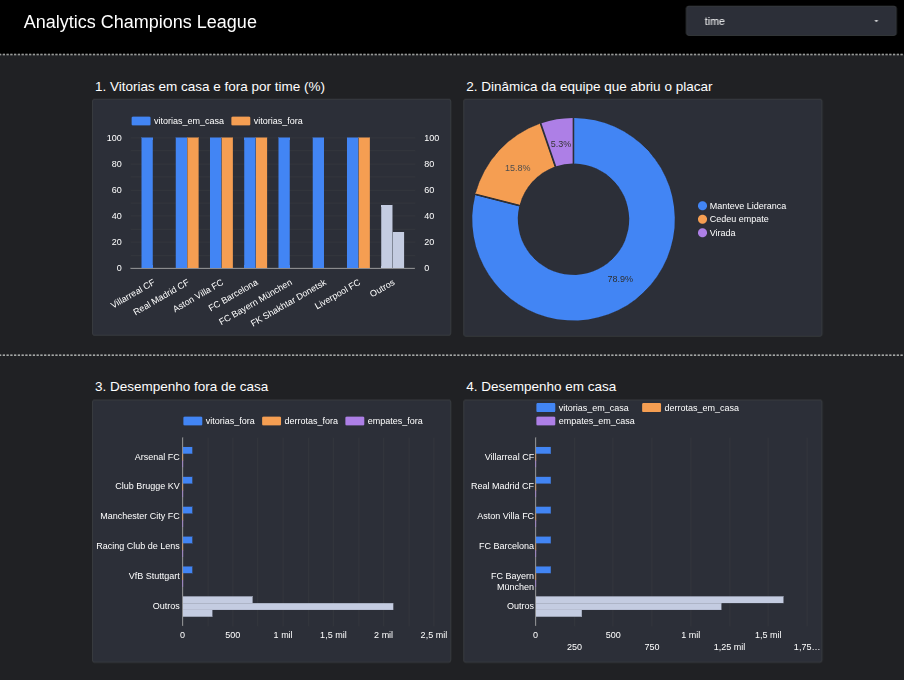

Autor: Felipe Stillo Bretas

Este pequeno projeto foi criado com a intenção de me familiarizar com a base dos processos de ETL em engenharia de dados

Foi criado um pipeline ETL em arquitetura de medalhão (3 camadas: bronze, silver e gold) para analisar algumas estatísticas de partidas e equipes da Champions League, com a visualização final no Looker

Obs: Os dados são atualizados a cada 15 dias

# 1. Arquitetura: 

## 1.1  A ingestão dos dados é feita por meio da API da Football-data

## 1.2  Os dados são armazenados em JSON em um datalake no GCS em uma camada "raw" e depois vão limpos para um csv

    1.2.1 Na primeira etapa (Bronze) é feita apenas a extração e disponibilização em json.
    A limpeza e escolha de colunas e feita na camada silver antes de construir o CSV

## 1.3 A trasnformação dos dados é feita com Pandas para calcular as métricas desejadas sobre o desempenho de cada time

    1.3.1 Essa é a etapa gold onde são feitos todos os calculos e criação da nova tabela que ficará no banco de dados para alimentar o a etapa de visualização

## 1.4 O carregamento é feito posteriormente no Big query e as tabelas são sempre reescritas em todas as atualizações

## 1.5 OS dados são conectados no Looker para visualização facilitada

    1.5.1 Foram divididas inicialmente 4 tabelas: 
    1: Porcentagem de vitorias, empates e derrotas de cada equipe 
    2: Análise se a equipe que abriu o placar se manteve, sofreu empate ou derrota
    3: Taxa de vitórias, empates e derrotas FORA DE CASA
    4: Taxa de vitórias, empates e derrotas EM CASA

# 2. Tecnologias utilizadas: 

Python (Pandas, requests e python-dotenv)
Google cloude storage e Big query
Github actions (para a orquestração configurado via CRON)
Looker studio

# 3. ## Para visualizar os dados no Looker ##

Você pode testar os filtros e explorar os dados reais clicando no link abaixo:

**[Acessar o Dashboard Interativo no Looker Studio](https://datastudio.google.com/reporting/824e026a-41e4-4c36-a2ed-bb9a352ce268)**

